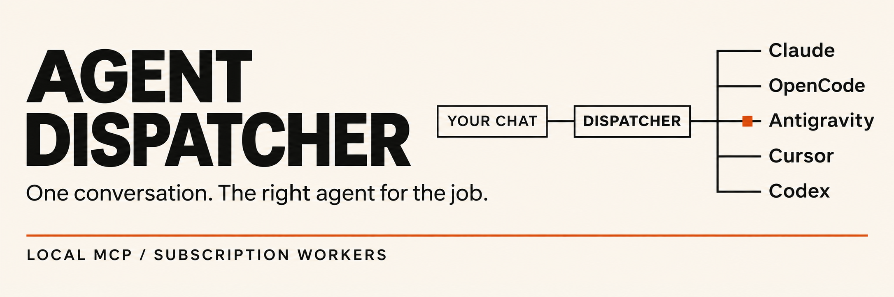

# Agent Dispatcher

[](https://github.com/Ameer-Jamal/agent-dispatcher/actions/workflows/ci.yml)
[](LICENSE)



**Use your coding subscriptions together. Keep one conversation.**

Agent Dispatcher is a local MCP server that lets your conversational agent delegate bounded work to Codex, Claude Code, OpenCode Go, Antigravity or Cursor. It chooses an eligible worker, runs the task in an isolated Git worktree, and returns the patch and check evidence to the originating coordinator for review.

Built for people who already pay for multiple agents and want suitable work routed between them without exhausting their main assistant's allowance.

**Local alpha · macOS · Node.js 22.13+ · Native subscription logins**

## What you can ask

> “Fix the bug described in this ticket, add a regression test, and have another agent review the change before we push.”
>
> “Update the test fixtures and lint dependencies. Use the subscriptions that make sense and preserve my Codex allowance.”
>
> “Investigate the timeout in this repository. Report the cause and a proposed fix before changing code.”

Installed coordinator policies authorize suitable delegation without requiring you to say “dispatch.” The coordinator gathers context, delegates, reviews the result and continues the conversation. Task state survives client disconnects and service restarts.

## How it works

1. **Describe the outcome** in your existing chat. The coordinator supplies a goal, repository, relevant files and acceptance checks.
2. **Route and execute.** Deterministic rules select an authenticated, enabled worker. A durable single-worker queue runs it in an isolated checkout, including a snapshot of relevant uncommitted work.
3. **Review and continue.** The coordinator inspects the incremental patch and actual check results, applies acceptable changes, and delegates a follow-up if needed. Conflicting edits are preserved.

Waiting, process monitoring and completion checks use ordinary code, not model calls. Workers do not recursively delegate. Merging and publishing require user authorization.

| Work                                                             | First-choice worker                |
| ---------------------------------------------------------------- | ---------------------------------- |
| Features and complex fixes                                       | Claude Code                        |
| Routine tests, renames, formatting, dependencies and small fixes | OpenCode Go                        |
| Broad debugging and investigation                                | Claude Code                        |
| Independent review                                               | Antigravity                        |
| Explicit requests or a concrete capability advantage             | Codex, subject to allowance policy |

Preferences are configurable. Cursor participates when enabled and its account has accessible models. These defaults are routing choices, not benchmark rankings. See [agent support](docs/agents.md).

## Quickstart

Install and sign in to the native worker CLIs you intend to use. Codex uses `codex login`; Claude Code uses `claude auth login` with subscription authentication (`claude.ai`).

```sh
git clone https://github.com/Ameer-Jamal/agent-dispatcher.git
cd agent-dispatcher
npm ci
npm run build
npm link

agent-dispatcher setup --root /absolute/path/to/your/projects
agent-dispatcher register
agent-dispatcher doctor
agent-dispatcher service install
```

`register` preserves existing settings and installs native MCP entries, coordinator instructions and supported lifecycle hooks. Reconnect clients afterwards. `doctor` checks authentication and available allowance without inference. Each task requires an allowed Git repository root with an existing commit; submodule repositories are not supported.

Codex and Claude workers are enabled by default. Enable additional subscriptions deliberately:

```sh
agent-dispatcher enable opencode
agent-dispatcher enable antigravity
agent-dispatcher enable cursor
agent-dispatcher doctor
```

OpenCode workers are restricted to the `opencode-go/` provider. No silent API-billing substitution, credit purchase or subscription change is performed. Provider-side extra-usage settings remain under your account's control.

## Keep the original conversation

**Codex:** completion delivery uses Snooze, detected during setup when configured. Its worker must be running and the task must identify the actual originating chat.

**Claude Code:** use the channel launcher for completion delivery:

```sh
agent-dispatcher claude
agent-dispatcher claude --resume SESSION_UUID
```

This enables Claude Code's custom development channel; it does not bypass permissions.

**Cursor, Antigravity and OpenCode:** native registration supports coordination, with durable inbox recovery. Automatic completion push into those chats is not implemented. Use `recover_tasks` after resuming rather than repeatedly polling.

**Muse:** a separately configured authenticated Mac gateway can expose dispatch, scoped waiting and reviewed finishing over Tailscale. A separate optional paired Muse transport supports explicit outbound requests. See [Muse gateway](docs/muse-gateway.md) and [paired Muse requests](docs/muse.md); neither guarantees wake-up of a closed conversation.

## Allowance and execution limits

- **Protect Codex:** automatic workers require fresh measured headroom above a configurable reserve, 30% by default. Explicit worker selection can override that reserve. It cannot bypass authentication or known exhaustion. The reserve does not cap your interactive chat's usage.
- **Report uncertainty:** Codex and Antigravity provide measured windows. Claude, OpenCode Go and Cursor remaining balances are unknown unless estimated. Status includes observation/reset times where available and observed quota cooldowns.
- **Keep native permissions:** allowed work runs unattended; denied actions return a blocked result. There is no unrestricted YOLO mode or relay for approving a worker prompt from another chat.
- **Supply external context:** workers have empty/isolated MCP configuration. The coordinator retrieves Jira tickets or other connected context and includes what the worker needs.
- **Recover safely:** one classified quota/availability failure permits a fallback. Other failures and uncertain execution require coordinator assessment. Notification delivery is distinct from confirmed receipt.

See [workflows and boundaries](docs/workflows.md) for remote coding examples, iterative delegation and the limits of computer control.

## Manage the service

```sh
agent-dispatcher status
agent-dispatcher recover /absolute/path/to/repository
agent-dispatcher get TASK_ID
agent-dispatcher cancel TASK_ID
agent-dispatcher service stop
agent-dispatcher service start
```

To remove the integration, run `service uninstall`, `unregister`, then `npm unlink -g @ameer-jamal/agent-dispatcher`. Private configuration and saved results are retained. Cursor User Rules added through its UI are removed there. See [configuration and interfaces](docs/reference.md) for state locations and lifecycle details.

## Documentation

[Configuration and tools](docs/reference.md) · [Architecture](docs/architecture.md) · [Coordinator policies](docs/coordinator-policy.md) · [Troubleshooting](docs/troubleshooting.md) · [Verification](docs/verification.md) · [Contributing](CONTRIBUTING.md) · [Security](SECURITY.md)

MIT licensed. Contributions and focused bug reports are welcome.
